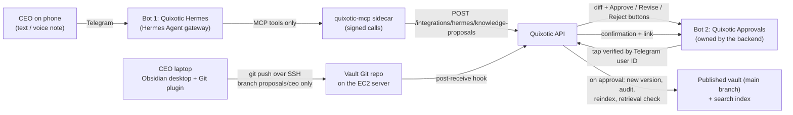

# Hermes + Telegram + Obsidian — research and step-by-step plan

Researched 2026-10-17. Implements PRD §9 (Hermes, Telegram and Discord knowledge ingestion), within §1, §3, §10, §11 and
§15. Owner decisions are in `docs/PRD_GAPS.md` §0.7; the milestone is "After M3" in `docs/P0_PLAN.md`.
**Nothing here is built yet.** It starts after M3 (vault, statuses, publication) and must not delay the §16 Phase 1 release.

---

## 1. The idea in one picture



Three rules hold everything together:

1. **Nothing becomes knowledge without approval** (§1, §9 step 5, §15). Telegram messages and Obsidian edits only ever
   create *proposals*. The published vault (`main` branch) is written only by the backend after an approval.
2. **Approval never goes through the AI.** The Approve button belongs to a second bot that the backend owns. The backend
   checks the tapping user's numeric Telegram ID against the approver list. Hermes has no approve tool at all.
3. **Hermes is locked down** (§15 "no open-ended Hermes filesystem/shell permissions"). No terminal, files, web, browser,
   code execution, memory or self-written skills. Its only tools are the few Quixotic tools listed in §4.

---

## 2. What the research found

### Hermes Agent (Nous Research)

- Open source (MIT), Python. Official Docker image `nousresearch/hermes-agent`; tags `stable`/`latest`, `X.Y.Z`, or pin by
  image digest. All state lives in one mounted data folder (`/opt/data`): `config.yaml`, `.env`, sessions, memories, skills.
  Run with `command: gateway run` and `restart: unless-stopped`. About 1 GB RAM without browser tools.
  Never run two gateway containers on the same data folder.
- **Telegram gateway:** create a bot with @BotFather, put `TELEGRAM_BOT_TOKEN` and `TELEGRAM_ALLOWED_USERS` (numeric IDs, not
  usernames) in `.env`. With no allowlist it denies everyone. Unknown DMs: set `unauthorized_dm_behavior: ignore`.
  Default is polling (outbound only, no open port). Webhook mode requires `TELEGRAM_WEBHOOK_SECRET`.
- **Voice notes:** built-in speech-to-text; provider `openai` uses `VOICE_TOOLS_OPENAI_KEY` (matches the owner's choice);
  `local` (faster-whisper) is the no-provider fallback. Bot API downloads are capped at 20 MB, which is minutes of voice.
- **Buttons:** Hermes's `clarify` tool shows inline buttons (used for "Is this transcript correct?"). Approval does *not*
  use this (rule 2).
- **Tools:** built-in toolsets include `terminal`, `file`, `web`, `browser`, `code_execution`, `memory`, `skills`,
  `delegation`, `cronjob`, `session_search`, `clarify`, `messaging`. They can be switched off
  (`agent.disabled_toolsets`, `hermes tools` per platform). Each MCP server becomes a toolset `mcp-<name>`; its tools can be
  allow-listed with `tools.include`.
- **Risk found:** Hermes "self-improves": it writes its own skills and keeps agent memory by default. That conflicts with
  §15 (no autonomous creation of company rules) and §8 (documents are data), so `memory` and `skills` must be disabled and
  the data folder checked for new skills in the tests.
- **Approvals/sandbox:** `approvals.mode`, `approvals.deny` and the Docker terminal backend exist, but the docs say the deny
  rules are "not a complete shell interpreter". So disabling the terminal toolset entirely is the containment, not deny rules.
- **Model:** needs at least 64k context. OpenAI is a supported provider, and so is any OpenAI-compatible endpoint
  (DeepSeek later).
- **Not confirmed by the docs (test in step H0):** a per-platform form of `disabled_toolsets`; whether a platform can run
  with *only* `mcp-quixotic` + `clarify`; whether Hermes passes the sender's Telegram ID to MCP tool calls.

### Obsidian + Git

- The Obsidian Git community plugin commits and syncs the vault from inside Obsidian on a timer ("every X minutes").
  On desktop it uses the installed Git (SSH keys work). On mobile it is slow and limited, so **the CEO uses Telegram on the
  phone and Obsidian on the laptop.** Don't install Obsidian on Linux via Flatpak/Snap (plugin docs).
- Server side, a plain Git repository over SSH is enough for one or two editors (no Gitea/Forgejo needed on a small EC2).
  A server hook can refuse pushes to any branch except the CEO's proposals branch.

### Telegram Bot API

- One bot token can only be read by one consumer (polling *or* one webhook). That is why there are **two bots**:
  Hermes owns Bot 1; the backend owns Bot 2 (webhook to the API, verified by Telegram's secret-token header).
- Inline keyboard buttons + `callback_query` give Approve / Revise / Reject taps; every tap carries the tapper's user ID.

---

## 3. What you (the owner) need to do

| # | Task | Notes |
|---|---|---|
| O1 | Create **Bot 1 "Quixotic Hermes"** with @BotFather (`/newbot`), keep the token | Never paste tokens in chat or code; they go to AWS Secrets Manager (§10) |
| O2 | Create **Bot 2 "Quixotic Approvals"** the same way | Separate token |
| O3 | Get the **numeric Telegram user IDs** of the CEO, Founder and any Knowledge Admin who may send or approve | e.g. message @userinfobot; usernames are not enough |
| O4 | Decide the **second approver** for high-impact topics (HR, pay, discounts, refunds, customer payments, security) | §9 step 5; proposed: a Knowledge Admin in the web Approvals page |
| O5 | Decide **retention** for original messages and audio | §9 step 2 |
| O6 | Decide what happens to a **rejected Obsidian edit** | proposed: backend reverts it on the CEO's branch and explains why in Telegram |
| O7 | Confirm OpenAI may receive the CEO's voice notes and messages | already the approved provider (2026-10-17); §10 |
| O8 | CEO laptop: install **Git** and **Obsidian** (desktop), one SSH key for the vault | step H4 walks through it |
| O9 | Discord now or later? | §9 allows it; this plan does Telegram only |

---

## 4. What we build — step by step

### H0 — Prove Hermes can be locked down (half a day, before anything else)

Run Hermes in Docker locally with a test bot. Pass only if all of these hold, otherwise use the fallback in §6:

- With `TELEGRAM_ALLOWED_USERS` set, an unlisted account gets no reply.
- With the config below, `hermes tools` (Telegram) lists only `clarify` and `mcp-quixotic` tools; asking it to "run a
  command", "read a file", "search the web" or "remember this" fails.
- No new files appear under `skills/` or `memories/` in the data folder after a session.
- Find out whether the sender's Telegram ID reaches MCP calls (decides how proposals are attributed, see H2).

```yaml
# /opt/data/config.yaml (sketch; exact keys confirmed in H0)
model: { provider: openai }            # key from OPENAI_API_KEY in .env; >= 64k context
toolsets: [hermes-telegram]
agent:
  disabled_toolsets: [terminal, file, web, search, browser, code_execution, memory, skills, session_search,
                      delegation, cronjob, image_gen, vision, todo, messaging, debugging]
approvals: { mode: manual, unattended_mode: deny, cron_mode: deny }
unauthorized_dm_behavior: ignore
security: { allow_private_urls: false }
stt: { enabled: true, provider: openai }
mcp_servers:
  quixotic:
    url: "http://quixotic-mcp:8765/mcp"           # internal Docker network only
    headers: { Authorization: "Bearer ${QUIXOTIC_MCP_TOKEN}" }
    tools:
      include: [search_approved_knowledge, create_knowledge_proposal, get_proposal_status, report_knowledge_gap]
      prompts: false
      resources: false
```

### H1 — Backend: proposals, approvers and the signed Hermes endpoint

- Tables (migration): `telegram_identities` (Telegram user ID ↔ company user, verified by an admin), `knowledge_proposals`
  (source = telegram | obsidian, sender, original text/transcript, intent, target document, Markdown body, before/after
  diff, status Draft → Under Review → Approved/Rejected/Revise, high-impact flag, approvals), `integration_messages`
  (platform message ID, chat, timestamp, retention date; §9 step 1).
- `POST /integrations/hermes/knowledge-proposals` (§11): accepts only requests signed by the MCP sidecar (HMAC over body +
  timestamp, rejects replays). Not reachable from the internet.
- Proposal builder (§9 step 4): search approved documents in the sender's scope, find conflicts, build the Markdown proposal
  and diff. A proposal is never authoritative; nothing is written to the published vault here.
- High-impact detection: department/category tags HR, pay, discounts, refunds, customer payments, security → needs a second
  approval (§9 step 5). ❓ the exact category list comes from M3's taxonomy.
- Knowledge-gap link: a proposal can resolve an open gap (§9 gap loop, M4 `knowledge_gaps`).

### H2 — `quixotic-mcp` sidecar (the only tools Hermes gets)

A tiny MCP server (HTTP, internal network) that signs and forwards to the API:

| Tool | Does | Never does |
|---|---|---|
| `search_approved_knowledge(query)` | searches published content the sender may see (§8 filters first) | return drafts or other people's chats |
| `create_knowledge_proposal(intent, title, department, body, target?)` | creates a proposal, returns its ID | publish or approve |
| `get_proposal_status(id)` | Under Review / Approved / Rejected / Published | — |
| `report_knowledge_gap(question)` | logs a gap (§9) | — |

Attribution: if H0 shows Hermes passes the sender's Telegram ID to tool calls, the sidecar forwards it; if not, run one
Hermes profile per allowlisted person (each with its own bot) so the sender is known from the bot. The LLM's own claim about
who is speaking is never trusted.

### H3 — Bot 2 "Quixotic Approvals" (backend-owned)

- Webhook `POST /integrations/telegram/approvals` behind the HTTPS proxy, checked with Telegram's
  `X-Telegram-Bot-Api-Secret-Token` header.
- For each proposal it sends: summary, department, before/after diff (long diffs as a link to the web Approvals page),
  sources found, conflicts, and buttons **Approve / Revise / Reject**.
- A tap is accepted only if the tapper's numeric ID maps to a user allowed to approve that department (§3). High-impact needs a
  second approver (O4) before publishing.
- On approval (§9 step 6): new version in the vault (`main`), audit event, reindex, a test retrieval that must find the new
  text, then a confirmation with the document link. On any failure (§9 step 7): keep the previous version, alert the owner,
  offer Retry/Rollback.

### H4 — Obsidian vault sync for the CEO

Server (EC2):

1. A `vault` Unix user with `git-shell` (no normal shell); the CEO's SSH public key in its `authorized_keys`.
2. Bare repo `/srv/vault.git`. `main` = published vault, written only by the backend (M3).
3. `pre-receive` hook: the CEO's key may push only `refs/heads/proposals/ceo`; force-push and pushes to `main` are refused.
4. `post-receive` hook: calls the API (signed, localhost) → the backend diffs `proposals/ceo` against `main` per file and
   creates one proposal per changed note → Bot 2 sends it for approval.
5. After each publish, the backend merges `main` into `proposals/ceo`, so the CEO's Obsidian shows what is live.

CEO laptop:

1. Install Git and Obsidian (desktop). Create an SSH key; send only the *public* key to the admin.
2. `git clone vault@<server>:/srv/vault.git` and `git checkout proposals/ceo`; open that folder as an Obsidian vault.
3. Install the **Obsidian Git** community plugin; turn on auto commit-and-sync every 10 minutes (pull + push).
4. Write notes with the M3 front-matter (department, category, sensitivity, owner…); a template is provided by M3.

### H5 — Deployment on the EC2 server (Docker Compose, M7)

```yaml
# added to the M7 compose file (sketch)
services:
  hermes:
    image: nousresearch/hermes-agent@sha256:<pinned digest>     # implementation necessity, listed in PRD_GAPS §4
    command: gateway run
    restart: unless-stopped
    volumes: [ "/srv/hermes:/opt/data" ]                         # config.yaml + .env written from Secrets Manager
    networks: [ hermes_net ]                                     # reaches only quixotic-mcp; outbound to Telegram + OpenAI
    deploy: { resources: { limits: { memory: 1536M, cpus: "1.0" } } }
    # no ports: polling needs none; API_SERVER and dashboard stay off
  quixotic-mcp:
    build: ./integrations/mcp
    restart: unless-stopped
    networks: [ hermes_net, backend_net ]
```

- Secrets (`TELEGRAM_BOT_TOKEN`, approvals bot token, `OPENAI_API_KEY`, `VOICE_TOOLS_OPENAI_KEY`, MCP token, HMAC key) come
  from AWS Secrets Manager at start-up (§10), never from the repo.
- Hermes adds roughly 1–1.5 GB RAM; size the instance in M7's load test with that included.
- Backups: `/srv/vault.git` and `/srv/hermes` join the nightly backup (§16 g).
- Upgrades: change the pinned digest, run H6 tests on staging, then `docker compose pull && up -d`.

### H6 — Tests (must pass before go-live)

- Unlisted Telegram user → ignored; listed but unmapped → refused.
- No message, voice note or Obsidian push ever changes published content without an approval tap.
- An approval tap from a non-approver ID is refused; high-impact needs two different approvers.
- Hermes cannot run commands, read files, browse, or write skills/memory (repeat of H0 against the deployed config).
- The MCP endpoint rejects unsigned, re-played or altered requests; it is not reachable from the internet.
- Failed reindex or retrieval check keeps the previous version and alerts the owner.
- A push to `main` or a force-push from the CEO's key is refused by the hook.
- Voice: transcript shown to the CEO with "Is this correct?" before the proposal is created.

---

## 5. Order of work and rough effort

| Step | Depends on | Effort (estimate) |
|---|---|---|
| O1–O9 owner tasks | — | can start any time |
| H0 Hermes lock-down spike | O1 (a test bot) | ½ day |
| H1 backend proposals + endpoint | M3, M4 | 3–4 days |
| H2 MCP sidecar | H1 | 1–2 days |
| H3 approvals bot | H1 | 2 days |
| H4 Obsidian Git sync | M3 vault | 1–2 days |
| H5 deployment | M7 compose | 1 day |
| H6 tests + staging run with the CEO | all | 2 days |

## 6. Fallback if Hermes cannot be locked down (H0 fails)

Keep the same design but replace Bot 1's Hermes with a small Python Telegram bot inside the backend that calls the configured
LLM for intent detection and OpenAI for transcription. Everything else (proposals, approvals bot, Obsidian sync) is unchanged.
This needs owner approval, because the owner asked for Hermes and §11 names it.

## Sources

- Hermes Agent docs: [Telegram](https://hermes-agent.nousresearch.com/docs/user-guide/messaging/telegram),
  [Security](https://hermes-agent.nousresearch.com/docs/user-guide/security),
  [Docker](https://hermes-agent.nousresearch.com/docs/user-guide/docker),
  [MCP](https://hermes-agent.nousresearch.com/docs/user-guide/features/mcp),
  [Tools](https://hermes-agent.nousresearch.com/docs/user-guide/features/tools),
  [Toolsets reference](https://hermes-agent.nousresearch.com/docs/reference/toolsets-reference),
  [Quickstart](https://hermes-agent.nousresearch.com/docs/getting-started/quickstart),
  [GitHub repository](https://github.com/NousResearch/hermes-agent)
- Obsidian Git plugin docs: [Start here](https://publish.obsidian.md/git-doc/Start+here)
- Telegram Bot API: [core.telegram.org/bots/api](https://core.telegram.org/bots/api)
