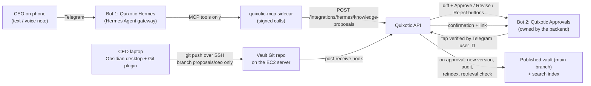

# Hermes + Telegram + Obsidian plan
Researched 2026-10-17. Implements PRD §9 within §1, §3, §10, §11, §15. Owner decisions: `docs/PRD_GAPS.md` §0.7; milestone "After M3" in `docs/P0_PLAN.md`.
**Status (2026-10-17): built.** H1–H5 in repo + tested. H0 (lock-down on real Hermes image) = checklist repeated on every Hermes upgrade. Must not delay §16 Phase 1.

## Built
| Piece | Where | Tested by |
|---|---|---|
| Signed Hermes endpoints: context, search, knowledge proposals (§11), proposal status, gaps | `backend/api/v1/integrations.py` | `tests/integration/test_hermes.py` |
| Sender confirmation: Hermes proposal stays `awaiting_confirmation` until linked Telegram account taps Confirm in approvals bot (model never acts in someone else's name) | `backend/integrations/approvals_bot.py` | AT-07 |
| Approvals bot (Bot 2): Confirm/Cancel, Approve/Reject (same rules as web), `/start` (shows Telegram ID), `/pending`, publication confirmation + link, gap notices. Webhook `POST /v1/integrations/telegram/webhook`; local poller `python -m workers.telegram_poll` | same file | AT-07 + high-impact test |
| quixotic-mcp sidecar (Hermes' only tools) | `integrations/mcp/` | `tests/test_mcp_sidecar.py` + HTTP smoke |
| Hermes config (tools locked, allowlist, OpenAI STT) | `deploy/hermes/config.yaml`, `SOUL.md`, `hermes.env.example` | H0 |
| Obsidian sync: push `proposals/<name>` -> proposals; `main` written only by backend; branch gets official note after publication | `backend/knowledge/vault_sync.py`, `deploy/vault/*` | Git round-trip + hook test |
| Linking accounts (Telegram IDs, Obsidian branches) | Admin -> System -> Integrations | admin test |
Server setup: `docs/DEPLOYMENT.md` §6–7.

## 1. Architecture

Rules:
1. Nothing becomes knowledge without approval (§1, §9 step 5, §15). Telegram/Obsidian only create *proposals*; `main` written only by backend after approval.
2. Approval never goes through the AI: Approve belongs to backend-owned Bot 2, which checks the tapper's numeric Telegram ID against approvers. Hermes has no approve tool.
3. Hermes locked down (§15): no terminal, files, web, browser, code exec, memory, self-written skills. Only the Quixotic tools in H2.

## 2. Research findings
**Hermes Agent (Nous Research):** MIT, Python. Docker image `nousresearch/hermes-agent` (tags `stable`/`latest`/`X.Y.Z`, or digest). State in one mounted folder `/opt/data` (`config.yaml`, `.env`, sessions, memories, skills). `command: gateway run`, `restart: unless-stopped`, ~1 GB RAM without browser. Never two gateways on one data folder.
- Telegram: @BotFather bot; `TELEGRAM_BOT_TOKEN`, `TELEGRAM_ALLOWED_USERS` (numeric IDs); empty allowlist denies all; `unauthorized_dm_behavior: ignore`. Default polling (outbound only); webhook needs `TELEGRAM_WEBHOOK_SECRET`.
- Voice: provider `openai` uses `VOICE_TOOLS_OPENAI_KEY` (owner's choice); `local` faster-whisper fallback. Bot API downloads capped 20 MB.
- `clarify` tool shows inline buttons (used for "Is this transcript correct?"); not used for approval (rule 2).
- Toolsets: `terminal`, `file`, `web`, `browser`, `code_execution`, `memory`, `skills`, `delegation`, `cronjob`, `session_search`, `clarify`, `messaging`; disable via `agent.disabled_toolsets` / `hermes tools`. Each MCP server = toolset `mcp-<name>`, allow-list with `tools.include`.
- **Risk:** Hermes self-improves (writes skills, keeps memory) -> conflicts with §15, §8; disable `memory` + `skills`, tests check data folder for new skills.
- Deny rules "not a complete shell interpreter" -> disabling terminal toolset is the containment.
- Needs >=64k context model; OpenAI or any OpenAI-compatible endpoint (DeepSeek later).
- Unconfirmed (test in H0): per-platform `disabled_toolsets`; platform with only `mcp-quixotic`+`clarify`; whether sender's Telegram ID reaches MCP calls.

**Obsidian + Git:** Obsidian Git plugin auto commit/sync on timer; desktop uses installed Git (SSH ok); mobile slow -> CEO uses Telegram on phone, Obsidian on laptop. Don't install Obsidian via Flatpak/Snap. Server: plain Git repo over SSH enough (no Gitea); hook refuses pushes except CEO's proposals branch.

**Telegram Bot API:** one token = one consumer (polling or one webhook) -> **two bots**: Hermes owns Bot 1; backend owns Bot 2 (webhook, Telegram secret-token header). Inline keyboards + `callback_query` give taps carrying tapper's user ID.

## 3. Owner tasks
| # | Task | Notes |
|---|---|---|
| O1 | Create Bot 1 "Quixotic Hermes" (@BotFather `/newbot`), keep token | tokens never in chat/code; AWS Secrets Manager (§10) |
| O2 | Create Bot 2 "Quixotic Approvals" | separate token |
| O3 | Numeric Telegram IDs of CEO, Founder, Knowledge Admins who send/approve | e.g. @userinfobot |
| O4 | ❓ Second approver for high-impact topics (HR, pay, discounts, refunds, customer payments, security) | §9 step 5; proposed: Knowledge Admin in web Approvals |
| O5 | ❓ Retention of original messages + audio | §9 step 2 |
| O6 | ❓ Rejected Obsidian edit handling | proposed: backend reverts on CEO's branch, explains in Telegram |
| O7 | Confirm OpenAI may receive CEO voice/messages | approved provider 2026-10-17; §10 |
| O8 | CEO laptop: Git + Obsidian desktop, one SSH key | H4 |
| O9 | ❓ Discord now or later? | §9 allows; plan = Telegram only |

## 4. Steps
### H0 — Prove lock-down (before anything else)
Run Hermes in Docker with a test bot. Pass only if all hold, else §6 fallback:
- With `TELEGRAM_ALLOWED_USERS`, unlisted account gets no reply.
- `hermes tools` (Telegram) lists only `clarify` + `mcp-quixotic` tools; "run a command"/"read a file"/"search the web"/"remember this" fail.
- No new files under `skills/` or `memories/` after a session.
- Determine if sender's Telegram ID reaches MCP calls (decides H2 attribution).
```yaml
# /opt/data/config.yaml (sketch; exact keys confirmed in H0)
model: { provider: openai }            # key from OPENAI_API_KEY in .env; >= 64k context
toolsets: [hermes-telegram]
agent:
  disabled_toolsets: [terminal, file, web, search, browser, code_execution, memory, skills, session_search,
                      delegation, cronjob, image_gen, vision, todo, messaging, debugging]
approvals: { mode: manual, unattended_mode: deny, cron_mode: deny }
unauthorized_dm_behavior: ignore
security: { allow_private_urls: false }
stt: { enabled: true, provider: openai }
mcp_servers:
  quixotic:
    url: "http://quixotic-mcp:8765/mcp"           # internal Docker network only
    headers: { Authorization: "Bearer ${QUIXOTIC_MCP_TOKEN}" }
    tools:
      include: [search_approved_knowledge, create_knowledge_proposal, get_proposal_status, report_knowledge_gap]
      prompts: false
      resources: false
```
### H1 — Backend proposals, approvers, signed endpoint
- Migration tables: `telegram_identities` (Telegram ID <-> user, admin-verified), `knowledge_proposals` (source telegram|obsidian, sender, original text/transcript, intent, target doc, Markdown body, before/after diff, status Draft -> Under Review -> Approved/Rejected/Revise, high-impact flag, approvals), `integration_messages` (platform msg ID, chat, timestamp, retention date; §9 step 1).
- `POST /integrations/hermes/knowledge-proposals` (§11): only HMAC-signed (body+timestamp) requests from MCP sidecar; rejects replays; not internet-reachable.
- Proposal builder (§9 step 4): search approved docs in sender's scope, find conflicts, build Markdown + diff. Never authoritative; nothing written to published vault.
- High-impact (HR, pay, discounts, refunds, customer payments, security) needs second approval (§9 step 5). ❓ exact category list from M3 taxonomy.
- A proposal can resolve an open gap (§9 gap loop, M4 `knowledge_gaps`).
### H2 — `quixotic-mcp` sidecar (HTTP, internal network; signs + forwards)
| Tool | Does | Never |
|---|---|---|
| `search_approved_knowledge(query)` | searches published content sender may see (§8 filters first) | return drafts / others' chats |
| `create_knowledge_proposal(intent, title, department, body, target?)` | creates proposal, returns ID | publish/approve |
| `get_proposal_status(id)` | Under Review/Approved/Rejected/Published | — |
| `report_knowledge_gap(question)` | logs gap (§9) | — |
Attribution: if Hermes passes sender's Telegram ID, sidecar forwards it; else one Hermes profile per allowlisted person (own bot). LLM's claim of who speaks is never trusted.
### H3 — Bot 2 "Quixotic Approvals" (backend-owned)
- Webhook `POST /integrations/telegram/approvals` behind HTTPS proxy, checked via `X-Telegram-Bot-Api-Secret-Token`.
- Sends summary, department, before/after diff (long -> link to web Approvals), sources, conflicts, buttons **Approve / Revise / Reject**.
- Tap accepted only if tapper's ID maps to a user allowed to approve that department (§3); high-impact needs second approver (O4).
- On approval (§9 step 6): new version in `main`, audit event, reindex, test retrieval must find new text, confirmation with doc link. On failure (§9 step 7): keep previous version, alert owner, offer Retry/Rollback.
### H4 — Obsidian sync for CEO
Server (EC2):
1. `vault` Unix user with `git-shell`; CEO's SSH public key in `authorized_keys`.
2. Bare repo `/srv/vault.git`; `main` = published vault, backend-only writes (M3).
3. `pre-receive`: CEO's key may push only `refs/heads/proposals/ceo`; force-push and `main` pushes refused.
4. `post-receive`: signed localhost API call -> backend diffs `proposals/ceo` vs `main` per file, one proposal per changed note -> Bot 2.
5. After each publish backend merges `main` into `proposals/ceo`.

CEO laptop:
1. Install Git + Obsidian; create SSH key; send only the *public* key to admin.
2. `git clone vault@<server>:/srv/vault.git`, `git checkout proposals/ceo`; open as vault.
3. **Obsidian Git** plugin: auto commit-and-sync every 10 min.
4. Notes use M3 front-matter (department, category, sensitivity, owner…); M3 provides template.
### H5 — EC2 deployment (Compose, M7)
```yaml
# added to the M7 compose file (sketch)
services:
  hermes:
    image: nousresearch/hermes-agent@sha256:<pinned digest>     # implementation necessity, listed in PRD_GAPS §4
    command: gateway run
    restart: unless-stopped
    volumes: [ "/srv/hermes:/opt/data" ]                         # config.yaml + .env written from Secrets Manager
    networks: [ hermes_net ]                                     # reaches only quixotic-mcp; outbound to Telegram + OpenAI
    deploy: { resources: { limits: { memory: 1536M, cpus: "1.0" } } }
    # no ports: polling needs none; API_SERVER and dashboard stay off
  quixotic-mcp:
    build: ./integrations/mcp
    restart: unless-stopped
    networks: [ hermes_net, backend_net ]
```
- Secrets (`TELEGRAM_BOT_TOKEN`, approvals bot token, `OPENAI_API_KEY`, `VOICE_TOOLS_OPENAI_KEY`, MCP token, HMAC key) from AWS Secrets Manager at start (§10), never repo.
- Hermes adds ~1–1.5 GB RAM; include in M7 load-test sizing.
- Nightly backup includes `/srv/vault.git`, `/srv/hermes` (§16 g).
- Upgrade: change pinned digest, run H6 on staging, `docker compose pull && up -d`.
### H6 — Tests (before go-live)
- Unlisted Telegram user ignored; listed-but-unmapped refused.
- No message/voice/Obsidian push changes published content without an approval tap.
- Non-approver tap refused; high-impact needs two different approvers.
- Hermes can't run commands, read files, browse, or write skills/memory (H0 vs deployed config).
- MCP endpoint rejects unsigned/replayed/altered requests; not internet-reachable.
- Failed reindex/retrieval check keeps previous version, alerts owner.
- Push to `main` or force-push from CEO key refused.
- Voice: transcript shown with "Is this correct?" before proposal creation.

## 5. Order / effort
| Step | Depends on | Effort |
|---|---|---|
| O1–O9 | — | any time |
| H0 | O1 | ½ day |
| H1 | M3, M4 | 3–4 d |
| H2 | H1 | 1–2 d |
| H3 | H1 | 2 d |
| H4 | M3 vault | 1–2 d |
| H5 | M7 compose | 1 d |
| H6 + staging run with CEO | all | 2 d |

## 6. Fallback if H0 fails
Same design, but Bot 1 = small Python Telegram bot in backend calling configured LLM for intent and OpenAI for transcription; proposals, approvals bot, Obsidian sync unchanged. Needs owner approval (owner asked for Hermes; §11 names it).

## Sources
Hermes docs (hermes-agent.nousresearch.com/docs): user-guide/messaging/telegram, user-guide/security, user-guide/docker, user-guide/features/mcp, user-guide/features/tools, reference/toolsets-reference, getting-started/quickstart; github.com/NousResearch/hermes-agent. Obsidian Git: publish.obsidian.md/git-doc/Start+here. Telegram: core.telegram.org/bots/api.
