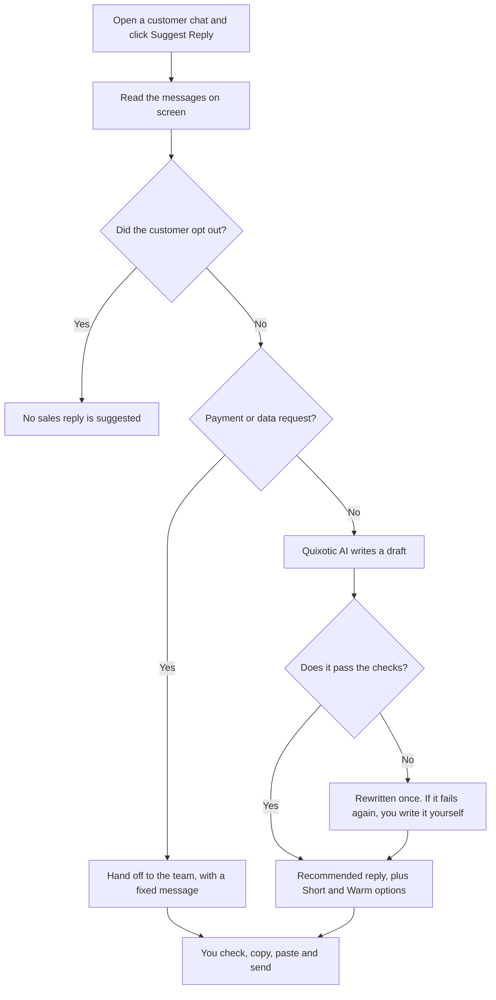

# Quixotic Reply Assistant

A Chrome extension that helps Quixotic staff reply to customers. Open a chat, click **Suggest Reply**, and get a private draft from Quixotic AI in a side panel. You check it, copy it and send it yourself.

**The extension never sends messages, never types into the chat, and never stores the chat.**

## What you need

- **Google Chrome** on a computer. The Discord desktop app is not supported, so open Discord in Chrome.
- **A Quixotic AI account** on [maqsad.quixoticcreatives.com](https://maqsad.quixoticcreatives.com), approved by your admin. Accounts that use two-step sign-in can't sign in to the extension yet, so use a regular employee account.

## Install (about 2 minutes)

You don't need to install anything else.

1. On this GitHub page, click **Code → Download ZIP**.
2. Right-click the downloaded file and choose **Extract All**. Keep the extracted folder somewhere permanent, because Chrome keeps loading the extension from it.
3. In Chrome, go to `chrome://extensions` and switch on **Developer mode** (top right).
4. Click **Load unpacked** and choose the folder that directly contains `manifest.json`.
5. Click the puzzle-piece icon on the Chrome toolbar and pin **Quixotic Reply Assistant**.

To update later, download the ZIP again, replace the folder's contents, and click the reload icon on the extension's card in `chrome://extensions`.

## First-time setup

Open any chat, then click the orange **Q** icon on the toolbar. The side panel walks you through this once:

1. **Sign in** with your Quixotic AI username or email and password.
2. **Add staff names**: type your team's names exactly as the chat shows them, separated by commas, for example `Sara | Quixotic, Bilal`. Everyone else is treated as the customer, so include your own name.
3. Optional: open **⚙ → My reply style** and describe how you like to write. It is saved only in your browser.

## How it works



## Daily use

1. Open the chat and scroll so the messages you want are on screen. Only what is loaded on the page is read.
2. Optional: pick your role: **Fresh seller**, **Upseller** or **Support**.
3. Click **Suggest Reply**.
4. Read the card at the top. It shows the chat stage, what the customer wants, and the suggested next step.
5. Choose a version, using **Use** to swap in **Short** or **Warm**. You can also use the **Shorter**, **Warmer**, **More direct** and **More natural** buttons, or **Regenerate**.
6. Open **Why did AI suggest this?** to see which customer messages the reply is based on.
7. Click **Copy Reply**, paste it into the chat, edit it if needed, and send it yourself.

### What the messages mean

| You see | What it means | What to do |
|---|---|---|
| **No sales reply: the customer opted out** | The customer said no to sales or contact | Don't pitch or follow up. **Write a non-sales reply anyway** is there if they also asked something else |
| **Hand off to the team** | They want to pay, or asked about their data | Send the fixed message, then have the team deal with it. Never paste a payment link the AI wrote |
| **Quixotic AI has no approved answer** | The company knowledge doesn't cover this | Write it yourself, or report the missing information in Quixotic AI |
| **No suggestion passed the checks** | The draft broke a rule twice | Write it yourself |
| ⚠ warnings under the reply | Something to double-check, such as a price that isn't in the chat | Confirm it before sending |

## Supported sites

| Site | How messages are read |
|---|---|
| Discord (discord.com) | Automatically |
| Twitch (twitch.tv and the creator dashboard) | Automatically |
| X (x.com direct messages) | Automatically |
| Any other website | Highlight the conversation first, then click **Suggest Reply**. Chrome asks permission for that site the first time |

The readers depend on each site's page layout, so they can break if a site changes it. Highlighting the conversation also works as a fallback when a reader finds nothing.

## The other tabs

- **Client Brain** (the customer's "Mini Brain"): facts staff have confirmed about this customer, such as their games, style and platform. The extension suggests facts from the chat, but saves only the ones you tick. Confirmed facts make replies more personal.
- **History**: what has been saved about this customer, and when.
- **Artwork Ideas**: three artwork ideas for this customer, for staff use.

## Rules built into the code

- Drafts are never sent automatically.
- If a customer opts out, nothing salesy is suggested.
- Payment and data requests go to a person, and the AI is not asked.
- Replies that invent prices, discounts, links or delivery promises, or claim you watched a stream or play a game, are rewritten or blocked.
- Customer messages are treated as data, so text like "ignore your instructions" has no effect.
- Quixotic AI enforces your account's permissions on the server.

## Privacy

- Chats are read only when you click, and only from the tab you have open.
- The extension itself stores no chat. To write a draft, the visible messages are sent to Quixotic AI.
- Your staff names, reply style and role are saved in your browser. Sign-in uses your own Quixotic AI account.
- Customer facts are saved to Quixotic AI only after you confirm them.

Follow each platform's rules, and use this only for conversations you are part of.

## Troubleshooting

| Problem | Fix |
|---|---|
| **Failed to fetch** | Quixotic AI can't be reached. Check your internet, try the website, and tell your admin if it's down |
| **Wrong username or password** | Sign in on the Quixotic AI website first. If that fails too, ask your admin about your account |
| **No chat found on screen** | Open the conversation and let it load, or highlight it, then try again |
| **I could not read this page** | Reload the page, click the orange **Q** icon, and allow the site if asked |
| The customer and staff are mixed up | Check the names in **⚙ → Change staff names**. They must match the chat exactly |
| The panel doesn't open | Check that the extension is switched on in `chrome://extensions`, then click its reload icon |
| **Manifest file is missing** when loading | You picked the wrong folder. Choose the one that directly contains `manifest.json` |

## For developers

Needs [Node.js](https://nodejs.org) 22 or newer.

```bash
npm install
```

```bash
npm test
```

| Command | What it does |
|---|---|
| `npm test` | Runs all the tests (no server or browser needed) |
| `npm run pack` | Builds a clean copy in `dist/` for **Load unpacked** |
| `npm run dev -- <folder> --watch` | Keeps the copy in `<folder>` up to date, and the loaded extension reloads itself |
| `node scripts/harness.js` | Opens the real panel at `http://localhost:8765/panel.html` with a fake Chrome API and fake AI server |
| `npm run icons` | Redraws the icons |

```text
manifest.json, background.js   Chrome extension setup
panel.html, panel.js           The side panel
readers/                       Read messages from Discord, Twitch, X or highlighted text
lib/gate.js                    Opt-outs and handoffs, decided before the AI is asked
lib/stage.js                   Chat stage and what the customer wants
lib/conversation.js            Builds the request to Quixotic AI
lib/draft.js                   The whole flow, from chat to checked draft
lib/verify.js, lib/guard.js    Checks every reply
lib/warnings.js                Warnings shown to staff
lib/client.js, lib/facts.js, lib/profile.js   Mini Brain
tests/                         Tests, using made-up chats
scripts/                       Build and development tools
```

Comments that mention `backend/`, `docs/`, `CLAUDE.md` or "PRD" refer to the main Quixotic AI project, which is not part of this repository. The extension uses the production server set in `lib/auth.js`.
